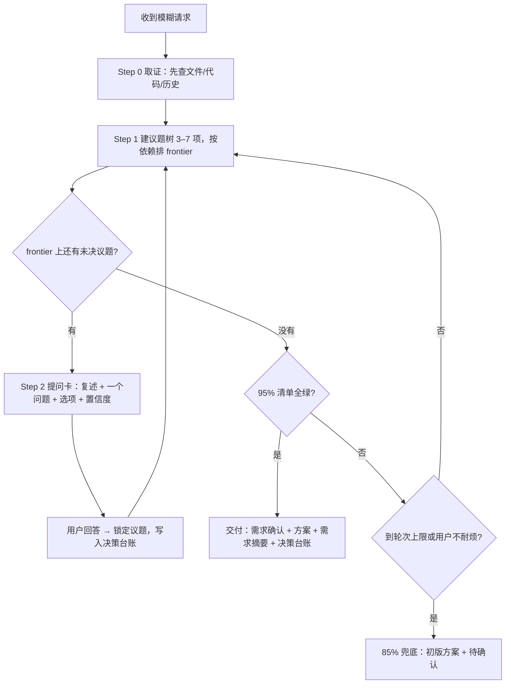

# 反向提问 Skill — README

> [!abstract] 一句话定位
> 用户需求模糊时，先苏格拉底式追问、再开工。==把用户脑子里的承重决策搬到桌面上==，而不是当订单接收员。

本技能回答一个问题：**在动手之前，我是否真的知道用户要什么？** 它不负责反驳用户的决定——那是 [[devil-advocate]] 的活。

## 何时触发

| 场景 | 例子 |
|------|------|
| 需求模糊、欠定义 | "帮我做个小工具""优化一下""搞个功能" |
| 跳过了关键决策 | 直接说方案，没说给谁用、为什么做 |
| 用户主动求拷问 | "grill me""拷问我""面试我""stress-test 我的方案" |

> [!warning] 不触发的情况
> 用户已经明确决定、只是请你评估该不该做——转 [[devil-advocate]]。用户只是告知事实、不需要你行动——什么都不触发。

## 设计：原机制 + grill-me，融合而非替换

旧版（v1）是纯苏格拉底式追问；新版（v2）吸收了 [grill-me](https://github.com/RobMitt/grill-me-skill) 的推进结构，==原有机制一条没删==，新增机制叠加在它上面。

| 能力 | v1 原有 | v2 新增 | 融合后的规则 |
|------|---------|---------|--------------|
| 提问节奏 | 一轮一问 | 按决策依赖排序（frontier） | 先问最上游的议题，再逐层深入 |
| 提问形式 | 开放式提问 | 2–4 个具体选项 + 推荐项 | 能枚举就给选项（推荐项放第一），开放题仍然开放问 |
| 信息获取 | 全靠问用户 | 能自查的不问 | 先查文件/代码/历史，查不到的才进议题树 |
| 单题信息量 | 问题本身 | 为什么问 / 选错的后果 | 三件套骨架 + 选项后果说明 |
| 收敛判断 | 自评置信度 95% | frontier 清空 + 轮次上限 | 两者同时满足才交付；置信度绑定已锁定议题数 |
| 交付物 | 需求摘要四维表 | 决策台账 + 假设 + 待确认 | 摘要在前、台账在后，两者都出 |
| 提问伦理 | 不设问诱导 | 推荐项必须标注 | 推荐要写理由，选项必须含反向/不做项 |

> [!important] 冲突时取更严格者
> 例如"给推荐"与"不诱导"并不矛盾：推荐可以给，但必须标注为推荐、说明理由，并且选项里至少有一个反向或"不做"。

## 文件结构

```
反向提问/
├── SKILL.md                  # 技能主文件（228 行），Agent 加载的入口
├── README.md                 # 本文件，人类阅读的说明
├── SKILL.md.bak              # v1 原始版本备份
└── references/
    └── question-tree.md      # 6 类任务的议题树 + 提问卡好/坏对照
```

- [[SKILL.md]] — 规则、流程、检查清单、输出格式
- [[question-tree]] — 按任务类型查议题树：软件开发 / PPT 汇报 / 数据分析与 CAE / 自动化脚本 / 采购选型 / 生活事务

## 工作流程



## 提问卡模板

每轮的回答都长这样，==`当前理解` / `追问` / `置信度` 三件套任何一轮都不能省==：

```markdown
## 当前理解
我认为你要的是一个能每天自动汇总数据的小脚本。
- 已锁定：运行在 Windows、结果发飞书
- 进度：2/6 个议题已锁定

## 追问
这个脚本失败时你希望怎么处理？

A. 只发告警，人工重跑（推荐）——实现最快，代价是你得盯着
B. 断点续跑——不用重头再来，但要多存一份进度状态
C. 静默重试三次再告警——无人值守，但可能掩盖真实故障

**为什么问这个**：它决定要不要引入状态文件，直接改变脚本骨架
**反过来选会怎样**：选 C 的话，日志里必须能看出重试次数，否则排查会很难

> 置信度：45%
```

### 停止条件

| 条件 | 动作 |
|------|------|
| 95% 清单全绿 + frontier 清空 | 正常交付 |
| 简单 ≤3 问 / 中等 ≤6 问 / 复杂 ≤10 问 | 到上限即出摘要，按推荐项继续 |
| 用户说"你看着办""先做吧" | 85% 兜底，假设显式列出 |

## 交付格式

交付时同时给两份东西，各管一件事：

1. **需求摘要**（四维体检）——核心目标 / 范围边界 / 关键约束 / 最高优先级，保证 Why、What、约束、优先级都落地。
2. **决策台账**（逐项流水）——每条结论都标明依据是"用户确认""我的推荐"还是"自行查证"，并配上「我做过的假设」和「待确认」。

> [!tip] 台账的真正用处
> 它让"聊了半天"变成一份可回头核对的清单，也暴露了哪些结论其实是你替用户拍的板——这些正是返工的高发点。

## 与 devil-advocate 分工

| 处境 | 用哪个 |
|------|--------|
| 不知道**要做什么** | 本技能：澄清需求、拷问方案分支 |
| 已经想做，判断**该不该** | [[devil-advocate]]：全力反驳 + 反转条件 |
| 两者接力 | 先本技能锁定"做什么"，再 devil-advocate 反驳"该不该" |

## 使用与生效

- Claude Code 启动时加载 `SKILL.md`；修改后通常热加载生效，若无反应重启会话。
- 触发方式：自然语言（"帮我做…""grill me"）或直接 `/反向提问`。
- 其他技能可复用其骨架，例如 [[ppt-restyle]] 的 Step 2 反问脚本（借用本技能骨架 + 最多 5 轮硬约束）。

## 变更记录

| 版本 | 日期 | 变更 |
|------|------|------|
| v1 | — | 苏格拉底式追问：七条核心规则、95% 五项清单、八个提问维度、需求摘要四维表 |
| v2 | 2026-11-09 | 融合 grill-me：议题树与 frontier、自查优先、选项与推荐、每题后果说明、轮次上限、决策台账；v1 全部机制保留，备份见 `SKILL.md.bak` |

## 参考

- [RobMitt/grill-me-skill](https://github.com/RobMitt/grill-me-skill) — grill-me 原始实现
- [rshedul-agentic-engineering / grill-me](https://github.com/Rijul1204/rashedul-agentic-engineering/blob/main/skills/grill-me/README.md) — 同事式追问的扩展版本
- 苏格拉底式提问法 — 一次一问、逐层深入、以问题暴露前提
